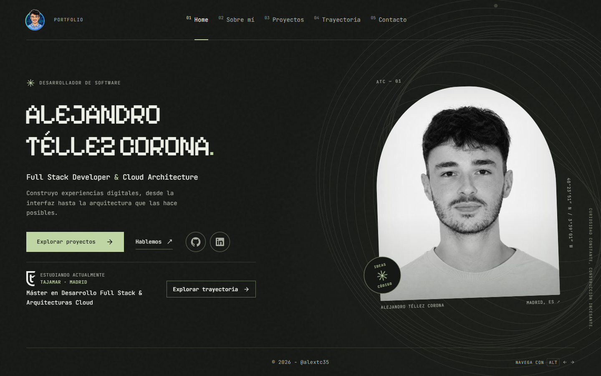

# Alejandro Téllez Corona — Portfolio

Portfolio personal con cinco secciones: Home, Sobre mí, Proyectos, Trayectoria y Contacto. Presenta los proyectos **New DeskTab** y **Steam Card API**, junto con la formación y experiencia profesional.



## Tecnologías

- **React y TypeScript** para los componentes, las vistas y los datos.
- **Vite** para desarrollo y compilación.
- **Tailwind CSS y CSS** para el diseño responsive.
- **Motion** para las transiciones y **Lucide** para los iconos.
- **JetBrains Mono y Pixelify Sans**, servidas localmente mediante Fontsource.
- **Playwright y axe** para las pruebas de navegador y accesibilidad.
- **Prettier** para el formato del código.

Aplicación estática, sin backend ni base de datos. Las imágenes y fuentes se sirven desde el propio sitio.

## Características

- Navegación por secciones con enlaces directos, historial, teclado y gestos táctiles.
- Diseño adaptable a móvil, escritorio y orientación horizontal.
- Galerías de proyectos con visor ampliado y navegación por gestos.
- Fichas de formación y experiencia con información ampliada en un modal.
- Precarga de fuentes e imágenes y transiciones compatibles con movimiento reducido.
- Contacto por correo, copia al portapapeles y enlaces a GitHub y LinkedIn.
- Metadatos sociales, datos estructurados, sitemap y contenido alternativo sin JavaScript.

## Desarrollo

Requiere Node.js 24 y npm.

```sh
npm ci
npm run dev
```

Vite muestra las direcciones local y de red del servidor de desarrollo.

## Comandos

| Comando                | Función                                            |
| ---------------------- | -------------------------------------------------- |
| `npm run dev`          | Inicia el servidor de desarrollo.                  |
| `npm run build`        | Comprueba TypeScript y genera la web en `dist/`.   |
| `npm run preview`      | Sirve la compilación de producción en local.       |
| `npm run check:build`  | Valida los recursos y metadatos de la compilación. |
| `npm run test:e2e`     | Ejecuta las pruebas de navegador.                  |
| `npm run format`       | Aplica el formato del código.                      |
| `npm run format:check` | Comprueba el formato sin modificar archivos.       |

Las pruebas utilizan Microsoft Edge por defecto. También admiten Chromium mediante `PLAYWRIGHT_CHANNEL=chromium`, con el navegador instalado por Playwright. Cubren navegación, gestos, modales, galerías, carga de recursos, adaptación de pantalla y accesibilidad.

## Estructura

```text
src/
  components/        Componentes compartidos y hooks
  data/              Perfil, proyectos, trayectoria y textos
  styles/            Estilos y adaptación de pantalla
  views/             Vistas del portfolio
assets/brand/        Fuente gráfica del favicon
public/
  images/            Fotografías, logos y capturas de proyectos
  licenses/          Licencias de las fuentes
build/               Generación de metadatos y contenido sin JavaScript
scripts/             Validación del build y generación de iconos e imagen social
tests/               Pruebas de navegador
```

Los contenidos se mantienen en `src/data/portfolio.ts`, `src/data/journeyDetails.ts` y `src/data/copy.ts`. La configuración del sitio utiliza las variables de `.env.example`.

El origen de los recursos gráficos y sus avisos de licencia se recogen en [ATTRIBUTIONS.md](ATTRIBUTIONS.md).
